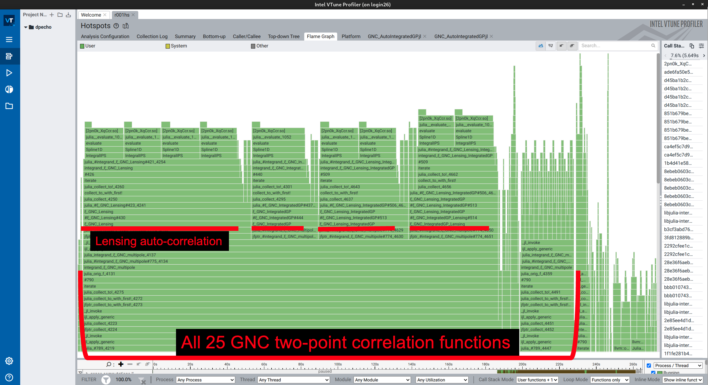
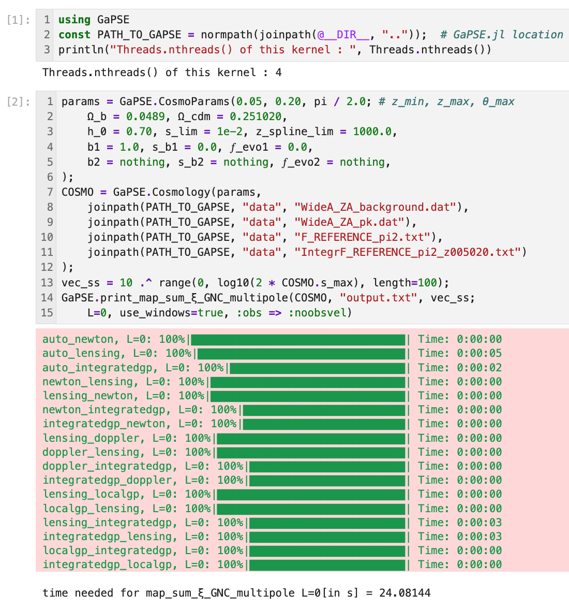

# Summary

`GaPSE.jl` (Galaxy Power Spectrum Estimator) is an open-source Julia package for computing 
the two-point statistics of relativistic effects in galaxy clustering at first order in perturbation theory. 
It computes Two-Point Correlation Functions of relativistic Galaxy Number Counts and Luminosity Distance perturbations, 
their cross-correlations, and the corresponding power spectra multipoles, with or without a survey window function.
The package allows users to compute individual contributions from the physical effects entering these observables, including
Doppler effect, lensing, and gravitational potentials. This decomposition consents to study the relative 
importance of each relativistic correction individually and their potential degeneracies with signals from local 
Primordial Non-Gaussianity, across different redshift bins, multipoles, and survey geometries.

# Statement of need

The current standard paradigm for the origin of structure formation in the Universe
is the inflation, i.e. an exponentially rapid growth of the Universe scale factor $a$ of about
28 orders of magnitude. Almost all inflationary models predict a flat universe and a nearly scale-invariant 
spectrum of initial fluctuations. Consequently, identifying observables that can discriminate between
these models is of utmost importance. Local Primordial Non-Gaussianities (PNG) are one of the most promising 
variables of this kind [@Achucarro:2022].

The standard parameterization of the local PNG is the so-called scale-independent $f_{NL}$ parameterization,
which would imprint a scale-dependent bias at low wavenumbers on the observable Power Spectrum [@Dalal:2008; @Slosar:2008].
However, on those scales, the pure Newtonian and plane-parallel approximations that underpin most clustering analyses cease to be adequate,
because the separation between a pair of galaxies becomes comparable to the distance from us to them.
Consequently, a full General Relativistic (GR) approach must be employed.

In such analysis, the GR effects manifest themselves in two groups of observables, that can be derived analytically [@Castorina:2022]: 
the Luminosity Distance (LD) fluctuations and the Galaxy Number Counts (GNC).
Due to the presence of the gravitational potential in many GR effects, some of these terms can mimic a PNG signal and bias its measurement.
For this reason, we need a deeper understanding of these GR effects,
especially for future surveys that aim to map the Universe on the largest scales, like Euclid [@Euclid:2011].
This is why we developed `GaPSE.jl`.

`GaPSE.jl` (Galaxy Power Spectrum Estimator) is an open-source code, written in the Julia programming language, that computes the
two-point statistics of these GR effects at first order in perturbation theory.
This enables users to assess the importance of relativistic corrections, compare them with the PNG signal, 
and investigate how survey geometry affects the resulting observables.

# State of the field

Existing publicly available codes address related but distinct observables.
Boltzmann codes such as `CAMB` [@CAMB:2026] and `CLASS` [@CLASS:2011] calculate angular power spectra of observed number counts, $C_\ell(z_i,z_j)$. 
This representation is exact, but these angular spectra are not directly the Fourier-space Power Spectrum multipoles 
commonly used in galaxy clustering analyses, and the translation from one to the other is non-trivial.
`GaPSE.jl` implements instead the Fourier-space formalism of @Castorina:2022, in which the observed Power Spectrum multipoles 
are obtained from the Yamamoto estimator, using the endpoint line-of-sight convention. Consequently, its outputs 
can be compared with the measured multipoles obtained from spectroscopic surveys directly, without an intermediate conversion from angular spectra.

`COFFE` (COrrelation Function Full-sky Estimator) provides a complementary approach, calculating full-sky and flat-sky 
galaxy two-point correlation functions and their multipoles, including relativistic and wide-angle effects [@COFFE:2018]. 
It also supports covariance calculations for relevant correlation-function estimators. These capabilities make `COFFE` 
an important existing alternative for analyses centered on galaxy number counts in configuration space.
`GaPSE.jl` differs in three respects: it computes also the Power Spectra multipoles (including an arbitrary survey window), 
rather than configuration-space correlation functions only; it extends the analysis to Luminosity Distance perturbations 
and their cross correlations with Galaxy Number Counts; and it includes a model for the local PNG contribution. 
In addition, a single function call in `GaPSE.jl` returns every auto- and cross-term separately together with their sum.
These capabilities make `GaPSE.jl` complementary to the currently existing tools and motivate its development as a separate package.

# Software design

The design of `GaPSE.jl` separates cosmological inputs from the calculation of the observables. 
Users provide two input files: the linear matter power spectrum at redshift $z=0$ and the background 
quantities of the chosen cosmology. Example files for a standard cosmology are provided in the `data` 
directory; users can generate equivalent files for their own cosmological models using `CLASS` [@CLASS:2011]. 
These inputs are loaded into a `Cosmology` Julia `struct`, which stores the cosmological parameters 
and the interpolating splines required by subsequent calculations. This allows multiple correlation 
functions and power-spectrum multipoles to be evaluated using the same cosmological setup.

Once a `Cosmology` object has been initialized, users can calculate the supported Two-Point Correlation 
Function (TPCF) multipoles for Galaxy Number Counts (GNC), Luminosity Distance (LD) perturbations, 
their cross-correlations, and the local Primordial Non-Gaussianity (PNG) contribution. Doppler and 
matter correlation functions in plane-parallel approximation are also available for comparison. 
Individual physical contributions are computed separately, rather than only as a total observable, 
allowing users to investigate their relative importance in the given `Cosmology`.

Survey geometry is incorporated through the `use_windows` boolean option. The package provides a toy-model 
window function with azimuthal symmetry for controlled tests and comparisons. For real applications, 
users can supply an arbitrary window function as a tabulated map.

The computational core of the package is the evaluation of the integrals for the TPCFs, which can involve,
depending on the term considered, 1, 2 or 3 nested integrals. The four contributions involving three nested integrals
(Lensing auto-correlation, Integrated Gravitational Potential auto-correlation, 
and their 2 cross-correlations) are by far the most computationally expensive contributions. The following profiling flame 
graph obtained with Intel VTune illustrates the computational workload involved in evaluating all 
25 GNC TPCFs, and the predominance of the aforementioned 4 terms:

However, the evaluation at each input point can be done independently from the others. This provides a 
straightforward strategy for parallelization over the requested input vector of distances, 
without introducing dependencies between evaluations. For example, the following code snippet computes 
all the 25 GNC TPCF multipoles and their sum over a logarithmically spaced set 
of separations (and saves them to a file):

The evaluations over `vec_ss` are distributed across the available Julia threads. In the tested configuration, 
four threads provide a speedup of approximately $3.5\times$ relative to single-threaded execution.

The Power Spectrum multipoles are computed using FFTLog-based algorithms provided by `TwoFAST.jl` [@Gebhardt:2018] 
and FFTLog.jl [@Bonici:2021]. These methods evaluate the required transforms efficiently, making the 
Power Spectra calculation comparatively inexpensive relative to the nested integrations required for the TPCFs.

Numerous Jupyter notebooks are provided in the directories `ipynbs` and `theory` to demonstrate how
to use the code and clarify important theoretical and computational aspects: among them, `ipynbs/TUTORIAL.ipynb`
shows the basic workflow step-by-step, `ipynbs/Generic_Window.ipynb` and `ipynbs/eBOSS_Window.ipynb` 
how to use a user-supplied window function and an application to a real survey window, respectively,
and `theory/threads_scaling.ipynb` the scaling of the parallel implementation. 
Finally, a Docker container with all the aforementioned features and files can be pulled from `foglienimatteo/gapse`.

# Research impact statement

`GaPSE.jl` has already supported published research. 
It was used to derive and analyze the large-scale limit of the observed galaxy power spectrum, 
including the potential degeneracy between relativistic contributions and local Primordial Non-Gaussianity [@Foglieni:2023]. 
It was subsequently used to investigate the power spectrum of Luminosity Distance fluctuations in General Relativity 
and their relevance to peculiar-velocity surveys [@Pantiri:2024]. 

The study reported in @Batia:2025 motivated an extension of `GaPSE.jl` to handle multiple galaxy populations 
within the same Cosmology instance. This extension enables the computation 
of cross-correlations between two galaxy populations with different values of the parameters $b_1$, 
$s_\mathrm{b}$, $\mathit{f}_{\mathrm{evo}}$ (galaxy bias, magnification bias and evolution bias, respectively).

# AI usage disclosure

No AI tools were used in the development of `GaPSE.jl` before and up to version `v0.8.0`.
Beginning with version `v0.10.0`, we took advantage of Claude Opus 5.4 and ChatGPT Astra
to investigate numerical issues and inconsistencies arising in specific corner cases, to improve the 
software documentation and assist in drafting and revising this manuscript. The authors reviewed and 
validated the AI-assisted contributions and take responsibility for the final software, documentation, and paper.

# Acknowledgements

We thank the Leibniz Supercomputing Centre (LRZ) and the University of Milan for their support.
We also thank Emanuele Castorina, Enea Di Dio, and Salvatore Cielo for their valuable contributions.

# References

